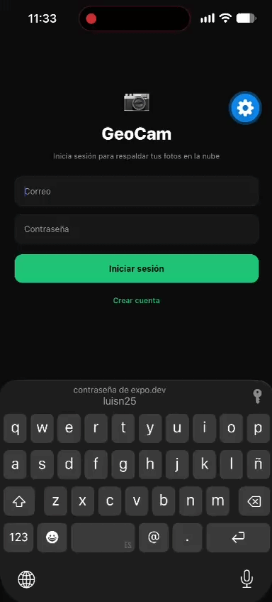
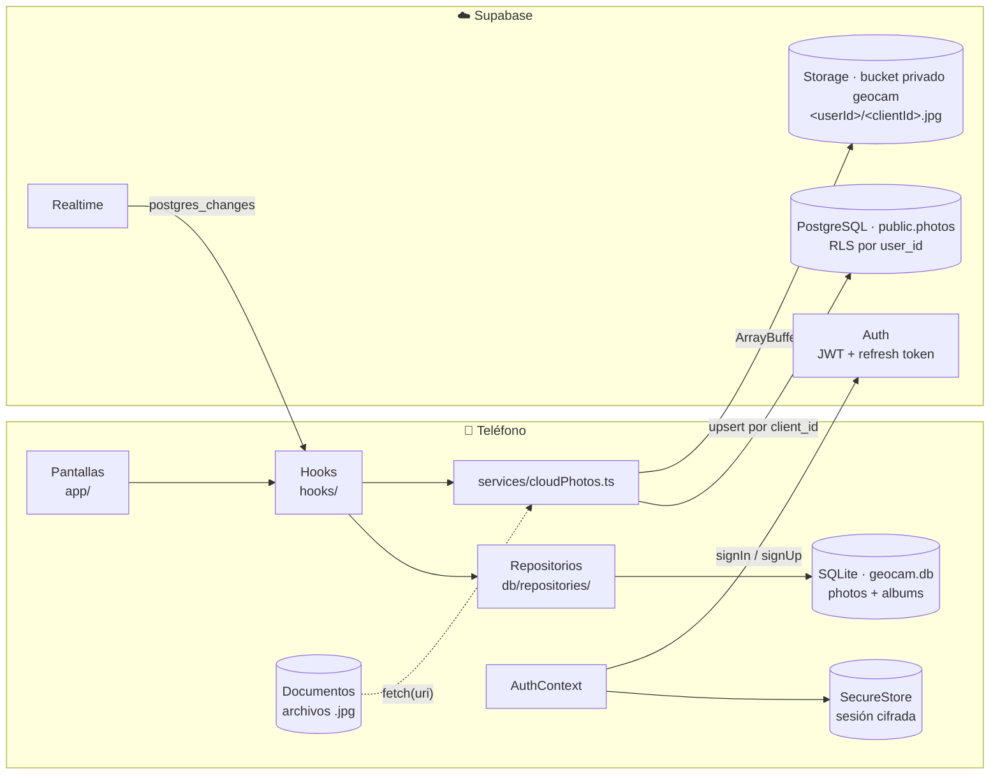
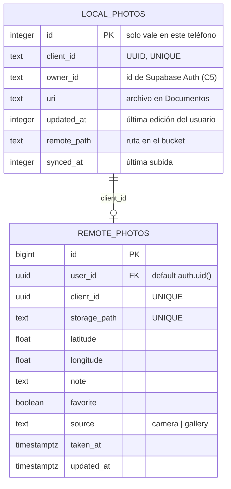
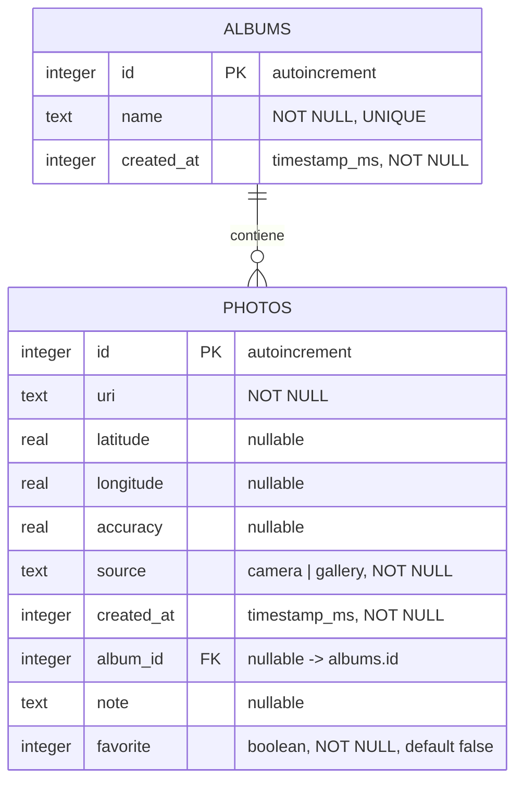
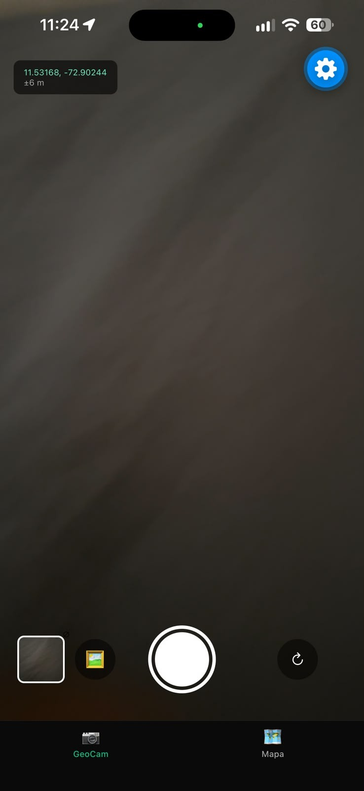
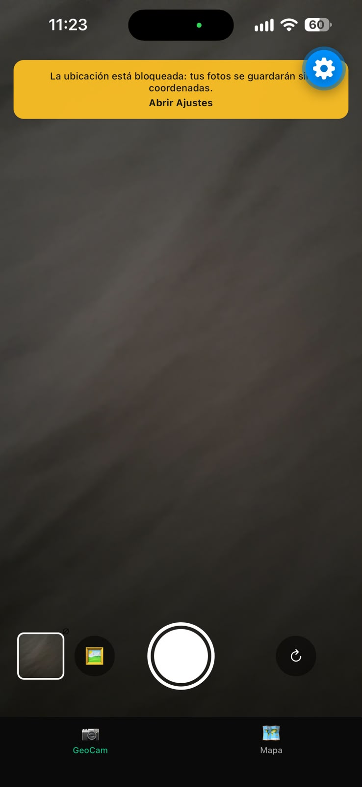
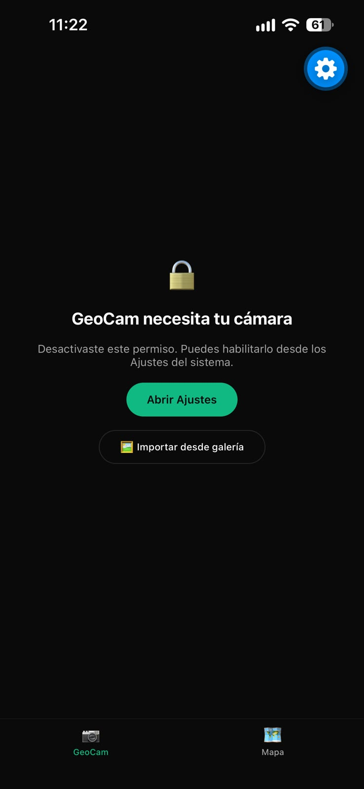

# GeoCam 📷📍

Cámara que etiqueta cada foto con coordenadas GPS, reacciona al movimiento del teléfono y guarda
todo en una base de datos local para funcionar sin conexión, con cuentas de usuario y respaldo en Supabase.
Taller Integrador 2 · **Semana 6: Módulos Nativos y Sensores** · **Semana 7: Persistencia con Drizzle ORM + SQLite** ·
**Semana 8: Backend as a Service con Supabase**.

**Integrantes:** Luis Nuñez, Amand Herrera

Construida con **Expo SDK 57**, Expo Router y TypeScript estricto. Todo el acceso al hardware
está encapsulado en Custom Hooks tipados (sin `any`) que exponen los errores como estado para la UI.

## Semana 8 – Backend as a Service con Supabase

GeoCam ahora tiene cuentas de usuario y un respaldo en la nube. **SQLite sigue siendo la fuente de verdad local**:
la app funciona igual sin internet, y Supabase es el respaldo y el punto de encuentro entre teléfonos.



### Las dos bases



`client_id` (UUID creado en el teléfono) identifica la **misma foto en los dos lados**; el `id` autoincremental solo
vale en cada base.



Una foto está **pendiente de subir** cuando `synced_at` está vacío o es anterior a `updated_at`.

### Taller en clase y trabajo para la casa

| Tarea | Implementación |
| --- | --- |
| T1. Cliente y credenciales | `lib/supabase.ts`; `.env` ignorado y `.env.example` versionado |
| T1. Sesión segura | `lib/secureStorage.ts`: la sesión se parte en fragmentos de 1000 caracteres dentro de SecureStore (Keychain / Keystore). No se usa AsyncStorage |
| T2. Autenticación | `context/AuthContext.tsx` (`onAuthStateChange`), `app/login.tsx`, botón **Salir** en Fotos |
| T2. Rutas protegidas | `app/_layout.tsx`: `Stack.Protected` para `(tabs)` y `foto/[id]`; `app/index.tsx` redirige según la sesión. Sin `router.replace` |
| T3. Backend | [`supabase/schema.sql`](supabase/schema.sql): tabla `photos` con RLS por dueño y bucket privado `geocam` |
| T4. Migración local | `drizzle/0003_*.sql`: `client_id`, `updated_at`, `remote_path`, `synced_at`. `ensureSyncFields()` rellena las fotos viejas |
| T5. Subida | `services/cloudPhotos.ts` → `uploadPhoto`; botón **☁️ Subir a la nube** en el detalle e ícono ☁️ en la lista |
| C1. Subir pendientes | Botón **☁️ Sincronizar** en Fotos con avance "3 de 7"; si una falla, las demás siguen y al final se informa |
| C2. Sin duplicados ni huérfanos | Archivo en `<userId>/<clientId>.jpg` (reutilizado si ya existe) + fila con `upsert` por `client_id`; si la fila falla se borra el archivo recién subido |
| C3. Borrado coherente | `deleteRemotePhoto`: comprueba conexión → fila remota → archivo → copia local. Sin internet avisa y no borra nada |
| C4. Pestaña Nube | `app/(tabs)/nube.tsx` + `hooks/useCloudPhotos.ts`: URLs firmadas en una sola petición y canal Realtime limpiado con `removeChannel` |
| C5. Datos locales por usuario | `drizzle/0004_*.sql`: `owner_id` con índice; todas las consultas de fotos filtran por el usuario de la sesión |
| C6. Auditoría de credenciales | Ver abajo |

### Seguridad: qué llave va dónde

| Llave | Dónde vive | Qué puede hacer |
| --- | --- | --- |
| Publishable key (`sb_publishable_…`) | `.env` → dentro del bundle de la app | Solo lo que permitan las políticas RLS |
| Secret key (`sb_secret_…`) | **En ningún lugar del proyecto** | Se salta RLS |
| Contraseña de la base de datos | Solo en el panel de Supabase | Conexión directa a PostgreSQL |

La publishable key **es pública** (cualquiera la extrae del APK). La seguridad la ponen RLS y Auth:

- `photos`: `select`, `insert`, `update` y `delete` solo cuando `auth.uid() = user_id`. `user_id` tiene
  `default auth.uid()`: la app nunca envía el id del usuario, lo pone la base a partir del token.
- Bucket `geocam` **privado**: solo se sube, lee y borra dentro de la carpeta `<auth.uid()>/`. Las imágenes se ven
  con URLs firmadas que vencen en 1 hora. Es privado (a diferencia del Muro de Clase) porque una foto con
  coordenadas es un dato personal.

### C6. Auditoría de credenciales

```bash
$ git log --all --full-history -- .env
                                          # sin resultados: .env nunca entró al historial
$ ls -a | grep env
.env.example                              # versionado, sin valores
$ git grep -nI -E "sb_secret_|service_role|SERVICE_ROLE" -- . ':!*.md'
                                          # sin resultados: no hay secret key en el código
$ git log --all -p | grep -cE "sb_secret_[A-Za-z0-9]|sb_publishable_[A-Za-z0-9]{10}"
0                                         # ninguna llave en ningún commit
```

`.gitignore` incluye `.env`, y `lib/supabase.ts` lee solo `EXPO_PUBLIC_SUPABASE_URL` y
`EXPO_PUBLIC_SUPABASE_PUBLISHABLE_KEY`.

### Preguntas para sustentar

1. **¿Por qué la publishable key puede estar en el código y la secret key no?** Todo lo que empieza por
   `EXPO_PUBLIC_` queda escrito en el bundle y cualquiera lo puede extraer del APK. La publishable key solo puede
   hacer lo que permiten las políticas RLS; la secret key se salta RLS y daría acceso total a la base.
2. **Si alguien extrae la publishable key del APK, ¿qué puede hacer?** Lo mismo que la app: crear una cuenta y
   leer, subir o borrar **sus propias** fotos. Sin la sesión de otro usuario no puede ver ni tocar filas ni
   archivos ajenos, porque RLS compara `auth.uid()` con `user_id` y con la carpeta del bucket.
3. **¿Qué pasa con la sesión si el usuario pasa 30 días sin abrir la app?** El access token (1 hora) ya venció,
   pero el refresh token sigue guardado en SecureStore. Al abrir la app, supabase-js lo usa para pedir un access
   token nuevo sin pedir la contraseña. Solo si el refresh token fue invalidado (cierre de sesión, cambio de
   contraseña o una política de expiración del proyecto) el usuario vuelve al login.
4. **¿Por qué la foto se sube antes que la fila, y qué problema crea ese orden?** Para que nunca exista una fila
   que apunte a un archivo que no está: la pestaña Nube mostraría una imagen rota. El problema contrario es un
   archivo huérfano si la fila falla. Se resuelve en `uploadPhoto` borrando el archivo recién subido antes de
   reportar el error (C2).

### Configuración para ejecutar

1. Crea un proyecto en Supabase y ejecuta [`supabase/schema.sql`](supabase/schema.sql) en el SQL Editor.
2. Copia `.env.example` como `.env` y pon la URL y la publishable key (*Project Settings → API Keys*).
3. Para practicar, desactiva *Confirm email* en *Authentication → Sign In / Providers → Email*.
4. `npx expo start -c` (el `-c` es necesario después de crear o cambiar el `.env`).

## Semana 7 – Persistencia offline-first

Las fotos ya no viven en memoria: se guardan en SQLite (`geocam.db`) con **Drizzle ORM** y sus archivos se
copian a la carpeta de documentos de la app. Al cerrar y reabrir Expo Go, o en modo avión, todo sigue ahí.


### Funcionalidades nuevas

| Requisito | Implementación |
| --- | --- |
| Persistencia de fotos | `db/schema.ts` + `db/repositories/photos.ts` + `hooks/usePhotos.ts` (`useLiveQuery`) |
| C1. Álbumes | Tabla `albums`; crear, renombrar y eliminar desde la pestaña **Fotos** (mantener presionado un álbum) |
| C2. Segunda migración | `drizzle/0001_*.sql`: tabla `albums` + columnas `album_id`, `note`, `favorite`, sin perder fotos |
| C3. CRUD completo | `app/foto/[id].tsx`: nota, favorita, mover de álbum y eliminar |
| C4. Búsqueda y filtros reactivos | Pestaña **Fotos**: búsqueda por nota, chips de álbum / "Sin álbum" / ★ Favoritas |
| C5. Archivos permanentes | `services/photoFiles.ts`: copia a `Paths.document/photos`; el archivo se borra con su registro |

### Diagrama de tablas



Una foto pertenece como máximo a un álbum. Si se elimina un álbum, sus fotos quedan **sin álbum** (no se borran).

### Arquitectura por capas

```
Pantalla (app/)  →  Hook (hooks/)  →  Repositorio (db/repositories/)  →  Drizzle + esquema (db/)  →  expo-sqlite
                         └→ Servicio de archivos (services/photoFiles.ts) → expo-file-system
```

- **Ninguna pantalla ni componente importa `drizzle-orm` ni `@/db`.** La única excepción es `app/_layout.tsx`,
  que ejecuta `useMigrations` y muestra un indicador de carga hasta que la base está lista.
- Los **repositorios** devuelven las consultas de lectura **sin ejecutar**; los **hooks** las ejecutan con
  `useLiveQuery`, que vuelve a consultar cuando cambia la tabla (requiere `enableChangeListener: true`).
- Los hooks convierten las filas planas al tipo de dominio `GeoPhoto` (`types/geo.ts`), así que las pantallas
  no dependen de Drizzle.
- `db/client.ts` abre la base con `openDatabaseSync('geocam.db', { enableChangeListener: true })` y ejecuta
  `PRAGMA foreign_keys = ON`, porque SQLite no aplica llaves foráneas si no se activa en cada conexión.

```
db/
  client.ts                 → conexión + PRAGMA (WAL, foreign_keys) + instancia de Drizzle
  schema.ts                 → tablas albums y photos, tipos inferidos
  repositories/photos.ts    → listQuery, withLocationQuery, filteredQuery, detailQuery, create, update, remove…
  repositories/albums.ts    → listQuery, create, rename, remove (transacción)
  devSeed.ts                → solo desarrollo: datos de prueba y medición (reto)
drizzle/                    → migraciones generadas por drizzle-kit (versionadas, NO se editan)
  0000_*.sql … 0004_*.sql, meta/, migrations.js
hooks/
  usePhotos.ts              → lista filtrada + fotos con ubicación + addPhoto/removePhoto/clearAll
  usePhoto.ts               → detalle reactivo + updateNote/toggleFavorite/moveToAlbum/remove
  useAlbums.ts              → álbumes + createAlbum/renameAlbum/removeAlbum
  useAlbumsVersion.ts       → refresca las consultas de fotos (que hacen join) al cambiar albums
  useDevTools.ts            → menú ⚙️ Dev de la pestaña Fotos (solo __DEV__)
services/
  photoFiles.ts             → persistPhoto / deletePhotoFile (API File, Directory, Paths)
```

### Migraciones

Las migraciones **se generan, nunca se escriben ni se editan a mano**:

```bash
# 1. Modifica db/schema.ts
# 2. Genera el SQL en drizzle/ (también actualiza drizzle/migrations.js)
npm run db:generate          # = npx drizzle-kit generate
# 3. Recarga la app: useMigrations aplica las pendientes al iniciar
```

> ⚠️ **No uses `npx drizzle-kit push`.** `push` modifica una base directamente sin dejar historial; en la app
> las migraciones se aplican en el teléfono a partir de los archivos versionados en `drizzle/`.

| Migración | Qué hace |
| --- | --- |
| `0000_nostalgic_blonde_phantom.sql` | Crea la tabla `photos` (uri, coordenadas `real`, origen, fecha). |
| `0001_daily_inertia.sql` | Crea `albums` (con índice único en `name`) y agrega `album_id`, `note` y `favorite` a `photos` con `ALTER TABLE … ADD`, por lo que las fotos existentes se conservan (`favorite = false`, el resto `NULL`). |
| `0002_modern_dagger.sql` | Reto: `CREATE INDEX photos_created_at_idx ON photos (created_at)` para la lista ordenada por fecha. |
| `0003_smooth_iron_fist.sql` | Semana 8 (T4): `client_id` (con índice único), `updated_at`, `remote_path` y `synced_at`, todas opcionales porque la tabla ya tiene filas. |
| `0004_clear_abomination.sql` | Semana 8 (C5): `owner_id` con índice `photos_owner_id_idx`. |

> **Nota:** `drizzle-kit` generó `album_id … REFERENCES albums(id)` **sin** `ON DELETE SET NULL` (la cláusula
> solo quedó en el snapshot). Por eso `albumsRepo.remove` desvincula las fotos y borra el álbum dentro de una
> transacción; así funciona igual en la base real. Detalles en el [AI-LOG](AI-LOG.md).

### Reto: índice en `created_at` y medición

En desarrollo, la pestaña **Fotos** muestra un botón **⚙️ Dev** (`hooks/useDevTools.ts` → `db/devSeed.ts`) con tres
acciones: insertar 1000 fotos ficticias (en lotes de 100 dentro de una transacción, coordenadas aleatorias cerca de
Riohacha), medir la lista (`console.time('listar 1000 fotos')` sobre `photosRepo.listQuery()`, promedio de 5
consultas) y borrar los datos de prueba.

| Medición (Android, Expo Go, 1003 filas) | Promedio de 5 consultas |
| --- | --- |
| Sin índice (migraciones `0000` + `0001`) | **118.8 ms** |
| Con índice (`0002`) | **105.5 ms** |

`EXPLAIN QUERY PLAN` de la consulta de la lista (`LEFT JOIN albums … ORDER BY created_at DESC`):

```
Sin índice:  SCAN photos
             SEARCH albums USING INTEGER PRIMARY KEY (rowid=?) LEFT-JOIN
             USE TEMP B-TREE FOR ORDER BY          ← ordena todas las filas en memoria
Con índice:  SCAN photos USING INDEX photos_created_at_idx
             SEARCH albums USING INTEGER PRIMARY KEY (rowid=?) LEFT-JOIN
```

**Interpretación:** el índice elimina el ordenamiento en memoria, pero con 1000 filas la mejora medida es pequeña
(~11 %). La mayor parte del tiempo es pasar las filas de SQLite a JavaScript, y entre las dos mediciones también se
activó el modo WAL y se reinició Expo Go, así que no toda la diferencia es del índice. La ventaja del índice crece con
el número de filas y es mayor cuando se usa `LIMIT` (paginación), porque SQLite puede detenerse sin leer toda la tabla.

> **Modo WAL:** `db/client.ts` ejecuta `PRAGMA journal_mode = WAL`. Al aplicar la `0002` en el teléfono apareció
> `database is locked`: conexiones de recargas anteriores de Expo Go con lecturas a medias bloqueaban el `COMMIT`.
> En WAL los lectores no bloquean a quien escribe. Ver el [AI-LOG](AI-LOG.md).

## Funcionalidades (Semana 6)

| Requisito | Implementación |
| --- | --- |
| Cámara con permisos | `hooks/useCamera.ts` + `components/PermissionPrimer.tsx` |
| Ubicación con permisos y seguimiento | `hooks/useGeoLocation.ts` |
| R1. Estado global de fotos | Semana 6: `GeoPhotosContext` en memoria → Semana 7: `hooks/usePhotos.ts` sobre SQLite |
| R2. Importar desde galería | `lib/photos.ts` → `launchImageLibraryAsync({ mediaTypes: ['images'] })`, `source: 'gallery'` (borde morado) |
| R3. Pestaña Mapa | `app/(tabs)/mapa.tsx`: un `Marker` por foto, miniatura al tocar, lista "Sin ubicación" |
| R4. Agitar para borrar | `hooks/useShake.ts` → `Alert` de confirmación |
| Reto: ubicación aproximada | `useGeoLocation().isApproximate` (precisión > 1 km) muestra aviso |

## Estructura

```
app/_layout.tsx             → migraciones → AuthProvider → Stack.Protected (Semana 8)
app/index.tsx               → redirige a /geocam o /login según la sesión
app/login.tsx               → registro e inicio de sesión (Semana 8)
app/(tabs)/_layout.tsx      → Tabs
app/(tabs)/geocam.tsx
app/(tabs)/mapa.tsx
app/(tabs)/fotos.tsx        → búsqueda, filtros y álbumes (Semana 7)
app/(tabs)/nube.tsx         → fotos guardadas en Supabase, en tiempo real (Semana 8)
app/foto/[id].tsx           → detalle y edición de una foto (Semana 7) + subir a la nube (Semana 8)
components/AlbumNameModal.tsx
components/Chip.tsx
components/PhotoImage.tsx   → imagen con placeholder si el archivo ya no existe
components/PermissionPrimer.tsx
components/StatusBanner.tsx
constants/theme.ts
context/AuthContext.tsx     → sesión de Supabase (Semana 8)
db/, drizzle/, services/    → ver "Arquitectura por capas"
services/cloudPhotos.ts     → subir, sincronizar, borrar y listar en Supabase (Semana 8)
supabase/schema.sql         → tabla, políticas RLS, bucket y Realtime (Semana 8)
hooks/useCamera.ts
hooks/useGeoLocation.ts
hooks/useShake.ts
hooks/usePhotos.ts, usePhoto.ts, useAlbums.ts, useAlbumsVersion.ts
hooks/useCloudSync.ts, useCloudPhotos.ts   → botón Sincronizar y pestaña Nube (Semana 8)
lib/supabase.ts, secureStorage.ts          → cliente y sesión cifrada por fragmentos (Semana 8)
lib/permissions.ts          → mapPermission(): respuesta de Expo → PermissionState
lib/photos.ts
types/geo.ts
```

## Máquina de estados de permisos

```
checking -> undetermined -> (acepta) -> granted
                         -> (rechaza) -> denied -> (rechaza de nuevo) -> blocked
blocked -> Linking.openSettings() -> (lo activa en Ajustes) -> granted
```

`lib/permissions.ts` traduce `{ status, granted, canAskAgain }` a `PermissionState`.
Cuando `canAskAgain === false` el estado es `blocked` y la UI muestra **"Abrir Ajustes"**.
Al volver a la app (`AppState` → `active`) los hooks vuelven a *consultar* (no pedir) el permiso,
de modo que si el usuario lo activó en Ajustes la pantalla pasa sola a `granted`.

## Capturas de los tres estados de permiso

| Concedido | Rechazado | Bloqueado |
| :---: | :---: | :---: |
|  |  |  |
| Cámara y ubicación concedidas: coordenadas en vivo (±6 m) | Ubicación rechazada: la cámara sigue funcionando, la foto se guarda sin coordenadas (∅) y el banner lo comunica | Cámara bloqueada: botón **"Abrir Ajustes"** y alternativa "Importar desde galería" |

> Capturas tomadas en un iPhone físico con Expo Go. En iOS el sistema da **una sola oportunidad**:
> al primer "No permitir", `canAskAgain` pasa a `false` y el estado va directo a `blocked`, por eso
> el banner de ubicación rechazada ofrece "Abrir Ajustes". En Android se ve primero `denied`
> ("Permitir ubicación") y solo tras el segundo rechazo `blocked`.

## Checklist de entrega

- [x] **Permisos en contexto, nunca al abrir.** Al montar, los hooks solo llaman a
  `getForegroundPermissionsAsync` / `useCameraPermissions` (consulta). El diálogo del sistema
  aparece solo al tocar "Permitir acceso" o el banner de ubicación.
- [x] **Si niegas la ubicación, la cámara sigue funcionando** y un banner lo comunica;
  la foto se guarda con `coords: null` y aparece en "Sin ubicación" en el Mapa.
- [x] **Botón "Abrir Ajustes"** en `PermissionPrimer` (cámara) y en el banner (ubicación) cuando
  el estado es `blocked`.
- [x] **Todas las suscripciones se limpian al salir de la pantalla.** Las pestañas no se desmontan,
  así que las pantallas pasan `useIsFocused()` como `enabled` a `useGeoLocation` y `useShake`;
  al perder el foco el efecto hace `subscription.remove()` (con bandera `cancelled` contra la
  condición de carrera) y la `CameraView` se desmonta. En desarrollo se registra
  `[useGeoLocation] cleanup: GPS detenido` y `[useShake] cleanup: acelerómetro detenido`.
- [x] **Hooks tipados, sin `any`** (`@typescript-eslint/no-explicit-any: error`), con `error: string | null`
  en el estado que retorna cada hook.

## Ejecutar

```bash
npm install
cp .env.example .env    # y llena la URL y la publishable key de Supabase (ver Semana 8)
npx expo start -c       # escanea el QR con Expo Go (teléfono físico)
# o, si el teléfono no está en la misma red:
npx expo start --tunnel
```

Verificaciones:

```bash
npx tsc --noEmit
npx expo lint
```

Para instalar módulos nuevos usa siempre `npx expo install <paquete>` (no `npm install`).

### Cómo probar cada estado

1. **Concedido:** abre GeoCam → "Permitir acceso" → acepta. Toca el banner amarillo → acepta la ubicación.
2. **Rechazado:** borra los datos de Expo Go (o reinstala) y rechaza el diálogo una vez.
3. **Bloqueado:** en Android, rechaza la cámara dos veces; en iOS basta un rechazo.
   Aparece "Abrir Ajustes"; actívalo allí y vuelve: la cámara se abre sola.
4. **Limpieza:** con la consola de Metro abierta, cambia a la pestaña Mapa y verifica el log de cleanup.
5. **Shake:** agita el teléfono con fotos guardadas → confirma el borrado.

## Notas

- En Expo Go se ven los textos de permiso genéricos de Expo Go; los de `app.json` solo aparecen en builds propios.
- Solo se pide ubicación en **primer plano** (`requestForegroundPermissionsAsync`).
- Escribir coordenadas en el EXIF requiere módulos fuera de Expo Go; por eso las coordenadas se guardan en
  columnas `real` de la tabla `photos` (Semana 7).
- Si la base queda inconsistente durante el desarrollo, **no borres migraciones**: borra los datos de Expo Go
  en el teléfono. La historia de `drizzle/` no se reescribe.
- En producción, `react-native-maps` en Android necesita una API key de Google Maps.
